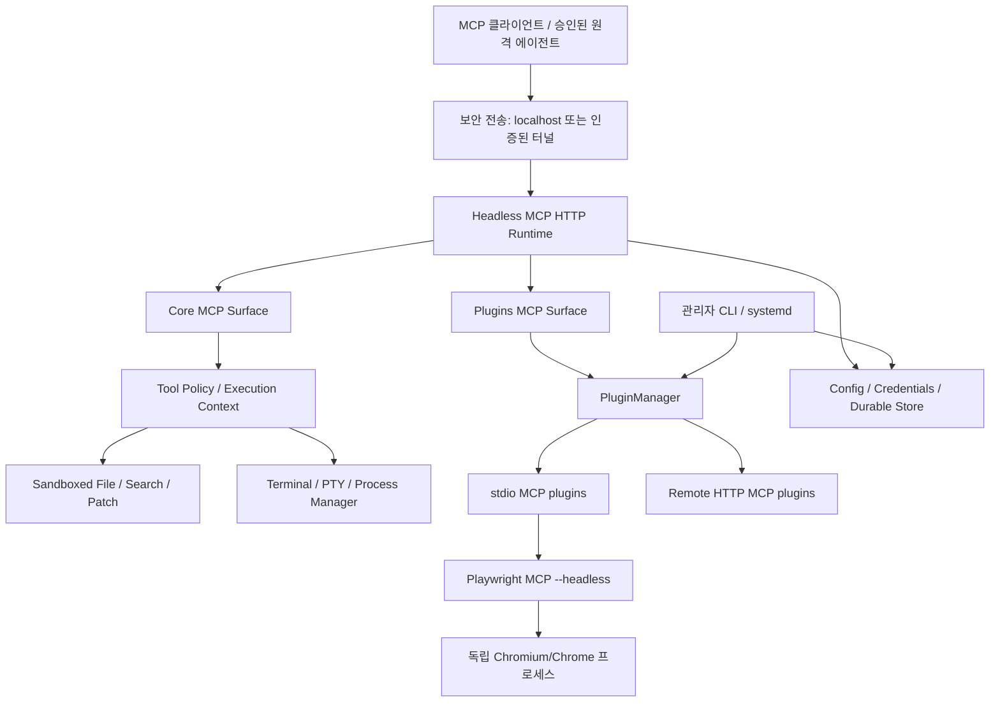

# Chat On Steroids — Ubuntu Server Headless Refactoring 기능명세서

> 문서 버전: **1.2.0 — RPi3 Venv Phase 0 정적 테스트 결과 반영 (설계안, 구현 전)**  
> 작성일: 2026-10-11  
> Upstream: [totec448-spec/chat-on-steroids](https://github.com/totec448-spec/chat-on-steroids)  
> 작업 대상: [ELSAPHABA/chat-on-steroids-headless](https://github.com/ELSAPHABA/chat-on-steroids-headless) / 브랜치 `feat/headless-refactoring`  
> 분석 기준: 두 저장소의 `main` 이 동일하게 가리키는 **`1d23ecdb8ab4dd5864f7f835778f539c51128526`**, 원본 `package.json` 버전 **2.1.34**  
> 경로: `refacoring_docs/Headless_Refactoring_Specification.md` (요청한 폴더 철자 보존)  
> 상태: 정적 소스·기존 문서 분석 완료 / 실제 Ubuntu Server 설치·통합 실행 검증은 미실시

## 0. Executive summary / 결론

**조건부로 구현 가능하다.** Electron 앱 전체를 Linux 서버에서 창 없이 실행하는 것이 아니라, 기존 Node.js/TypeScript의 **Core MCP + 외부 Plugin MCP 백엔드**를 독립적인 Node.js 데몬으로 분리하고, Electron·Chromium companion extension·ChatGPT 웹 UI 제어 의존성을 제거/격리하는 방식이 권장된다.

구현 범위는 두 수준으로 엄격히 분리한다.

1. **필수 범위 (MVP)**: Ubuntu Server에서 독립 실행되는 Core MCP 서버, 권한 제한된 파일/터미널/패치 작업, Plugins MCP proxy, 외부 MCP 플러그인 설치·연결·호출, Playwright MCP headless, CLI 설정, 보안·비밀정보 저장, systemd 서비스, 로그와 복구.
2. **별도 설계 승인 필요**: 기존 ChatGPT 브라우저 대화에서 동작하던 Worker 생성, 세션 관찰, Goal/Loop, Compact & Resume, 대화 기록의 자동 연동, 메시지 전송/완료 판단. 이 기능은 브라우저 확장 프로그램·브라우저 브리지·ChatGPT 웹 페이지의 상태 신호에 구조적으로 결합돼 있으므로 단순 포팅으로 유지할 수 없다.

**중요한 제품 경계:** Chrome/Edge/Brave용 **CoS companion 확장 프로그램**과 `src/main/browser-control.ts` 의 **ChatGPT/기존 탭 브라우저 컨트롤**은 리팩터링 대상에서 **제외**한다. 반대로 플러그인 카탈로그의 **`@playwright/mcp`는 반드시 포함**한다. Playwright MCP가 **자체 headless Chromium/Chrome 프로세스**를 실행하는 것은 허용된다. 이것은 CoS companion을 다시 구현하는 것이 아니다. **Blender MCP와 Unity MCP는 Headless 리팩터링 지원 범위에서 제외한다.**

**ChatGPT Plus/Pro UI를 확장 프로그램 없이 자동으로 조작하거나 그 구독을 API 호출처럼 사용하는 경로는 제공하지 않는다.** 외부 ChatGPT 클라이언트가 MCP를 직접 호출하는 경우와, 별도 모델 API를 이용해 자율 에이전트를 구현하는 경우는 서로 다른 제품 방식이다. 후자는 모델 제공자 API 사용 권한·비용·정책을 별도로 요구한다.

## 1. 요구사항 및 범위 계약

### 1.1 대상과 배포

- 목표 OS: Ubuntu Server **24.04 LTS x86_64 우선**, Ubuntu 22.04/26.04 및 Linux arm64는 검증 매트릭스에서 별도 확인. 커널·glibc·네이티브 모듈 호환 여부 확인 전까지 모든 조합의 지원을 선언하지 않는다.
- 목표 런타임: **Node.js 22 기준선 우선(원본 CI에서 검증됨)**. Node.js 24는 실제 패키지 및 MCP SDK의 추가 CI 호환 검증이 완료된 후 지원 여부를 결정한다. npm, TypeScript, Python/uv 및 선택적 Chromium은 기능별 의존성으로 분리한다.
- 동작 형태: **로그인 세션, 디스플레이 서버, Electron GUI, 트레이, Chromium companion extension 없이** SSH/systemd에서 상시 실행.
- 기존 원본 `main` 은 수정하지 않고 작업 브랜치에 단계별 작은 커밋을 쌓는다. 이번 요청은 **계획/명세서 작성**이며 런타임 소스 수정은 수행하지 않는다.

### 1.2 포함 / 제외 / 보류

| 영역 | 결정 | 조건 |
| --- | --- | --- |
| Core MCP 파일 읽기·쓰기·검색·패치 | **포함** | 승인된 루트 및 capability 기반 정책 유지 |
| `exec_command`/`write_stdin` 및 백그라운드 프로세스 | **포함** | 서비스 계정·프로세스 회수·세션 소유권 재정의 |
| MCP HTTP 서버, Core/Plugins surface | **포함** | headless bootstrap, 접근 제어 및 배포 경로 |
| 외부 MCP 플러그인: npm / Python / command / MCPB / remote | **포함** | 범용 설치/연결 프레임워크 유지, 기본 지원 카탈로그 5종만 검증 |
| **Playwright MCP (외부 플러그인)** | **필수 포함** | 자체 브라우저 사용, `--headless`, 설치 의존성 및 독립 테스트 |
| **Blender MCP / Unity MCP** | **제외** | Headless 기본 카탈로그에서 숨김/미포함; 전용 설치·실행·테스트·문서화·호환성 보장 대상 아님 |
| Skills, 프로젝트 워크스페이스, Git, 진단 로그 | **포함** | GUI·대화 ID 의존 부분은 분리 |
| OAuth 플러그인 연동 | **포함** | 서버에는 자동 브라우저 실행 없음; CLI URL 출력·원격 콜백 설계 |
| 터널(현재 OpenAI Secure Tunnel / cloudflared) | **선택적 유지** | 지원되는 방식·인증·운영 적합성 재검증 |
| **CoS Chromium/Firefox companion extension** | **제외** | `extension/` 포팅 금지, headless 빌드 제외 |
| **CoS 브라우저 컨트롤/내장 CoS Browser** | **제외** | `browser-control`, `cos-browser`, DOM/tab/화면 제어 미포함 |
| Electron renderer / preload / UI / Tray / Pet | **제외** | CLI·설정 파일·선택적 별도 웹 관리 UI로 대체 가능(기본 미구현) |
| Native Desktop/Computer Use | **제외** | Linux 지원 비활성화, Desktop surface 노출 금지 |
| ChatGPT 탭 연동 대화 기록·UI 기반 회복 | **제외** | 이 기능을 그대로 사용 가능하다고 주장하지 않음 |
| Goal/Loop, multi-worker, Compact & Resume | **보류** | 새로운 대화/작업 오케스트레이션 계약 필요 |
| OpenAI/다른 모델 API 기반 autonomous worker | **추후 선택 기능** | API 키·과금·정책 준수, 공식 인터페이스로만 구현 |

## 2. 실제 소스 기반 아키텍처 조사

### 2.1 원본 관찰

- `package.json`: Electron **44.3.0**, `electron-vite`, TypeScript **7.0.2**; `@modelcontextprotocol/server`, `@modelcontextprotocol/node`, `@modelcontextprotocol/client`, `node-pty`, `sharp`, `koffi`, `tree-sitter` 등 사용. 현재 `build` 는 Electron 번들을 생성하므로 서버 전용 빌드 명령이 없다.
- `src/main/index.ts`: Electron `app.whenReady()`, `app.getPath('userData')`, 창/트레이/알림/IPC 초기화 및 그 사이에 Core·Plugins·Secrets·Sessions·Durable·Tunnel 초기화가 혼합되어 있다. Headless 서버의 새로운 **독립 진입점**이 필수다.
- `src/main/mcp/server.ts`: `127.0.0.1` loopback, 비밀 경로 토큰, Host/Origin 검증, 요청 크기 제한, Core/Desktop/Plugins 경로를 가진 HTTP MCP 서버가 이미 분리돼 있다. 통신 계층을 재사용하되 원격 노출에 대한 인증·TLS 경계는 다시 명세해야 한다.
- `src/main/connection.ts` 및 `src/main/tunnel/index.ts`: MCP endpoint → OpenAI Secure Tunnel 또는 cloudflared 경로의 수명주기를 소유한다. 서버에서는 필요할 때만 별도 transport adapter로 활성화한다.
- `src/main/mcp/tools.ts` · `tools-core.ts` · `kernel.ts`: 파일·명령 도구와 등록 로직이 존재하지만, `tools-core.ts`의 `goalWorkerChat`, `kernel.ts`의 `unattributedRepairEta`, session/agents/request-correlation 등 **브라우저 기반 호출자 귀속**이 섞여 있다. API 표면만 떼어 내면 안 되고 호출 경로 전체를 분리해야 한다.
- `src/main/mcp/surfaces.ts`: `core`, `desktop`, `plugins` 3개 surface. Linux에서는 `src/main/platform.ts`가 native desktop automation 미지원으로 선언한다. Headless에서는 **desktop surface 자체를 등록하지 않는다**.
- `src/main/plugins/manager.ts`: `PluginManager`는 외부 MCP subprocess/HTTP transport, 도구 발견, enabled 정책, 결과 전달, 설치 상태의 중심이다. 기본 OAuth URL opener가 동적으로 `import('electron')` 해 `shell.openExternal` 을 호출하므로 반드시 주입식 CLI/OAuth provider로 교체한다.
- `src/main/plugins/installer.ts`: npm·Python/uv·MCPB·원격·사용자 명령형 소스 지원, 프로세스·설치 격리 로직 존재. `src/main/plugins/uv-runtime.ts`에 **linux-x64/linux-arm64** 자산이 존재하여 재사용 근거가 있다.
- `src/main/plugins/catalog.ts`: **`playwright`** 항목이 **`@playwright/mcp@0.0.80`** 으로 정의되어 있다(분석 기준 리비전). 원본 카탈로그에는 7종이 존재하나 **Headless에서는 Blender/Unity를 제외한 5종만 기본 지원**한다. 원본 Playwright 지침은 GUI Chrome을 전제로 하므로 Ubuntu Server 설치법과 `--headless` 옵션을 별도로 제공해야 한다.
- `src/main/plugins/oauth.ts`: OAuth 리다이렉트가 임시 `127.0.0.1` 포트를 사용한다. 브라우저가 다른 컴퓨터에 있는 서버 환경에서는 콜백 전달 설계 없이는 로그인 완료가 어렵다.
- `src/main/secrets.ts`: Electron `safeStorage`에 전적으로 의존하며 Linux `basic_text` fallback을 거부한다. **가장 먼저 교체해야 할 Electron 종속성** 중 하나이다.
- `src/main/durable.ts` · `src/main/session/store.ts`: `userData` 경로를 주입받는 파일 기반 저장 엔진이라 원칙적으로 재사용 가능하지만 session store는 ChatGPT 웹 메시지 ID를 가정하는 부분을 재검토해야 한다.
- `src/main/bridge.ts`: companion extension과 통신하는 대규모 HTTP 브리지이며, 브라우저 상태·결과 수신·대화 큐·복구 기능에 광범위하게 결합되어 있다. **서버 포팅이 아니라 제외**하는 방향이다.
- `src/main/goal.ts`: 외부 모델 API를 사용하는 **Goal 의사결정 기능 일부**가 이미 있지만 이는 주된 ChatGPT 실행 모델 및 브라우저 대화 전송을 대체하는 완전한 agent runtime이 아니다. 재사용 가능 함수만 추출하고 자동 작업 실행 가능성을 과장하지 않는다.
- `src/main/control-api.ts`: loopback 관리자 API 참고 구현이 있지만 `bridge.ts` 및 UI 상태 read 모델에 결합되어 있어 그대로 운영 관리자 API로 가져오지 않는다.

### 2.2 구성요소별 코드 변경 지도

| 소스(대표 파일/디렉터리) | 처리 | 구체 작업 |
| --- | --- | --- |
| `src/main/index.ts` | 분리 | Electron 부트스트랩을 쓰지 않고 `src/headless/main.ts` (제안)를 신설 |
| `src/main/mcp/server.ts` | 재사용/수정 | Core/Plugins만 빌드, secret/token·정지/drain 유지, listener 정책 주입 |
| `src/main/mcp/tools.ts`, `tools-core.ts`, `kernel.ts` | 핵심 리팩터링 | 브라우저·귀속·에이전트 종속성의 독립 인터페이스 주입, 기능별 등록 |
| `src/main/mcp/tools-plugins.ts` | 우선 재사용 | 기존 MCP schema / call proxy / code mode 보존 |
| `src/main/mcp/surfaces.ts` | 분리 | headless에서 Desktop surface 미노출 및 발견 계약 고정 |
| `src/main/config.ts`, `src/shared/types.ts` | 수정 | GUI 설정과 서버 설정 분리, Zod 검증, safe default |
| `src/main/secrets.ts` | 교체 | Electron-free Linux credential provider, 마이그레이션 명시 |
| `src/main/plugins/{manager,installer,oauth,uv-runtime}.ts` | 재사용/수정 | Electron opener 제거, headless OAuth 및 lifecycle, Playwright 옵션 |
| `src/main/plugins/catalog.ts` | Headless용 필터 적용 | Blender·Unity 제외, Memory·Playwright·Fetch·HeyGen·Recraft 5종만 기본 제공; 원본 데스크톱 카탈로그에는 영향 없음 |
| `src/main/connection.ts`, `tunnel/*` | 어댑터화 | 로컬 MCP와 원격 접근 분리, 터널은 opt-in |
| `src/main/{durable,logger,env,sandbox,fsops,rawfs,search}.ts` | 우선 재사용 | 경로/권한/배포 방식만 감사 |
| `src/main/codex/*` | 우선 재사용 | 리눅스 PTY/취소/종료/출력 한도/소유권 검증 |
| `src/main/{agents,goal}.ts`, `session/*` | MVP 부분 분리 | 브라우저 연동 없는 기능만 선정; 나머지 계약이 설계될 때까지 미노출 |
| `src/main/{bridge,browser-control,browser-startup}.ts`, `cos-browser/*` | 제외 | headless import graph에서 완전히 제거 |
| `extension/*`, `src/preload/*`, `src/renderer/*` | 제외 | headless 실행/패키징 아티팩트에 포함하지 않음 |
| `src/main/computer/*`, `tools-desktop*` | 제외 | Native desktop와 브라우저 제어 제공하지 않음 |
| `electron-builder.yml`, `electron.vite.config.ts` | 미사용 | 헤드리스 전용 build/package/CI 정의 추가 |

### 2.3 목표 구성도



**금지된 연결:** `extension/` → `bridge.ts` → ChatGPT DOM / tab automation 경로 및 Electron BrowserWindow / native Desktop surface는 위 런타임에 존재하지 않는다. Playwright MCP의 독립 브라우저는 **허용된 플러그인 하위 프로세스**다.

## 3. 목표 런타임과 인터페이스 계약

### 3.1 새 모듈(제안 경로)

```text
src/headless/
  main.ts                # node CLI / signal 처리 시작점
  bootstrap.ts           # 순서가 보장된 초기화·종료
  config.ts              # 서버용 설정/검증 및 마이그레이션
  host.ts                # XDG 경로/로그/환경 abstractions
  credentials.ts         # Linux secret provider
  policy.ts              # 승인된 root/capabilities/실행 권한
  transport.ts           # MCP local listener와 선택적 tunnel
  cli.ts                 # init, doctor, serve, plugins 관리
  plugin-auth.ts         # 관리자 브라우저에서 여는 OAuth URL 전달
  caller-context.ts      # transport identity와 요청 scope
  health.ts              # local-only 상태·ready 검사
```

위 경로는 **신규 제안**이며 현재 upstream에 존재하는 파일이라고 주장하지 않는다. 기존 구현을 중복 복사하기보다 `src/main`의 공유 모듈을 점진적으로 `src/backend` 등으로 이동할 수 있다. 이동 시 호환성 어댑터를 먼저 둔다.

### 3.2 환경 의존 인터페이스

- **HostRuntime**: 데이터 경로, 프로세스 시작·종료, 시그널, 시간, 로그를 Electron과 무관하게 제공.
- **SecretStore**: `get / set / delete / status`, 보호 상태 검증, 원자적 저장, 키 회전 및 복구 실패 정책.
- **AuthorizationPolicy**: 승인 루트·쓰기 권한·실행 권한·read-only 상태를 MCP 요청 시점에 평가. 관리 CLI와 MCP 요청 인증은 별개의 권한.
- **CallerContext**: 인증된 주체, request id, transport 세션, 승인된 root 및 작업 소유권을 분리. **ChatGPT의 웹 대화 ID를 헤더만 보고 신뢰하지 않는다.**
- **PluginAuthPresenter**: 브라우저 실행 대신 승인 URL을 관리자가 읽을 수 있게 출력하고 안전한 callback 경로를 운영.
- **OptionalConversationBackend**: MVP에서 null/unsupported; 확장 프로그램 이벤트를 가정하는 코드 호출 금지.

### 3.3 기동/종료 순서

1. 설정·디렉터리·시크릿 저장소·권한 정책 검증(필수 값 없으면 fail-closed).
2. 로그·durable·skills·플러그인 런타임 초기화.
3. 설치된 플러그인 상태 로드 → 활성 플러그인 연결과 도구 발견. 장시간 연결은 제한된 동시성/시간 초과로 격리.
4. Core/Plugins MCP 생성 → 요청을 받을 준비가 되었을 때 ready 상태 발행.
5. 선택적으로 승인된 터널 연결. 터널 실패는 로컬 서버와 저장 상태를 손상시키지 않아야 함.
6. SIGTERM/SIGINT 시 새 요청 차단 → 진행 중인 요청의 유한한 drain → 플러그인/PTY 자식 정리 → durable/log flush → 종료. systemd는 종료 제한 및 비정상 종료 재시작 정책 적용.
7. 이중 실행 방지는 Electron single-instance lock 대신 데이터 디렉터리 기준 잠금·PID/프로세스 생존 검사로 수행.

## 4. 핵심 기능명세

| ID | 우선순위 | 기능/수용 기준 |
| --- | --- | --- |
| HR-FR-001 | P0 | `cos-headless serve`를 SSH에서 실행할 때 `DISPLAY` 없이 서버 시작; Electron 모듈·BrowserWindow 초기화 없음 |
| HR-FR-002 | P0 | 승인된 root 이외 파일 접근 차단; realpath·symlink·TOCTOU 보안 회귀 테스트 |
| HR-FR-003 | P0 | Core `read/find/view_image/apply_patch/exec_command/write_stdin`를 실제 Linux FS/PTY에서 검증; 지원하지 않는 도구는 명시적 error |
| HR-FR-004 | P0 | Core/Plugins 별도 `tools/list` 및 `tools/call`; Core에서 Plugins 또는 Desktop 이름 우회 호출 불가 |
| HR-FR-005 | P0 | enabled·read-only·root 권한 변경이 신규 호출에 즉시 반영; 이미 등록된 도구의 거절은 명시적 `TOOL_DISABLED` |
| HR-FR-006 | P0 | 플러그인 install/configure/start/stop/update/uninstall, 설정·비밀값 저장·복원, 라이프사이클 관리 |
| HR-FR-007 | P0 | Plugins surface가 stdio와 원격 Streamable HTTP MCP를 정상 발견·호출·응답 전달; JSON schema/구조화 결과 보존 |
| HR-FR-008 | P0 | **Playwright MCP 플러그인** 자체 설치, `--headless` 실행, navigate/snapshot/click/screenshot 검증(디스플레이 없음) |
| HR-FR-009 | P0 | Playwright 사용 시 CoS extension·browser-control·CoS Browser가 런타임에 로드되지 않음 |
| HR-FR-010 | P0 | Linux용 암호 저장소에서 OAuth/플러그인/API 인증정보가 평문 config·로그·인자로 노출되지 않음 |
| HR-FR-011 | P1 | CLI를 통한 설정 초기화, 승인된 루트 추가/제거, capability 토글, 플러그인 관리 및 진단 |
| HR-FR-012 | P1 | OAuth remote plugin의 관리형 URL 출력, callback 검증, 실패·취소·만료 후 안전한 재시도 |
| HR-FR-013 | P1 | user-level systemd unit 및 서버 배포·업그레이드·롤백 절차; reboot 후 정상 재시작 |
| HR-FR-014 | P1 | session/process 작업별 소유권을 브라우저 ID와 독립적으로 식별, 다른 주체의 세션 제어 차단 |
| HR-FR-015 | P1 | 운영 상태 `health/ready`, 드레인·정지·로그·메트릭을 secret/token 누출 없이 확인 가능 |
| HR-FR-016 | P2 | 선택한 tunnel transport로 승인된 외부 MCP 연결; 실패·재연결·중복 터널 ID 테스트 |
| HR-FR-017 | P2 | 세션 기록·프로젝트 관리 등 GUI 없는 기능만 선별 이관, 저장 스키마 명시 |
| HR-FR-018 | **보류** | 원본의 ChatGPT 대화 관찰/자동 전송/Worker 생성/Goal/Loop/Compact & Resume의 1:1 호환을 요구하지 않음 |

### 4.1 Playwright 플러그인 상세 계약

- 원본 catalog source: `src/main/plugins/catalog.ts` 의 `playwright` / `@playwright/mcp@0.0.80`. 버전은 계획의 기준값이며 실제 개발 시 upstream 버전/CLI 호환성을 다시 확인하고 **검증한 버전으로 고정**.
- 플러그인 설치 흐름은 기존 `PluginSource.kind='npm'` 및 `args`를 이용하도록 우선 설계한다. `npm install --prefix` 후 생성되는 JS entrypoint에 `--headless` 인자를 추가하는 방식이 가능한지 설치 테스트로 확인.
- **헤드리스 옵션은 사용자 플러그인 설정 또는 headless preset으로 명시적 적용**. 모든 임의 플러그인에 자동 삽입하면 타 프로그램을 망가뜨리므로 Playwright 전용 preset을 둔다.
- Browser dependency: 기본 카탈로그는 Chrome 설치를 안내한다. 공식 Playwright MCP 옵션은 `--headless`이며 `--browser`·`--executable-path` 등의 세부 호환성은 **해당 고정 버전**에 맞춰 검증. Chrome 또는 버전 호환 Chromium, OS 공유 라이브러리를 별도로 설치한다.
- 공식 참고: [Playwright MCP configuration](https://playwright.dev/mcp/configuration/options), [Playwright browsers/dependencies](https://playwright.dev/docs/browsers). 브라우저와 라이브러리 설치는 build/운영 안내에 포함하고, 핵심 Core MCP에는 브라우저를 강제 설치하지 않는다.
- 필수 확인: `DISPLAY` unset, Chrome/Chromium 프로세스 생성, 각 도구 동작, 스크린샷·다운로드 저장 위치, 프로세스 종료 후 자식 누수 부재, 폰트/한글 렌더링 및 sandbox 여부.
- Linux에서는 Chrome의 `--no-sandbox`를 기본으로 강제하지 않는다. 격리된 서비스 사용자·user namespace 지원 여부를 확인한 뒤 최소 권한으로 운영한다.
- **엄격한 구분:** `@playwright/mcp`의 자체 브라우저는 포함. `extension/*`의 browser extension, `src/main/browser-control.ts`의 탭 제어 API와 `src/main/cos-browser/*`는 제외.

### 4.2 플러그인 분류별 적합성

**Headless 기본 지원 플러그인: 5종 (기존 7종에서 Blender·Unity 제외)**

| 기본 플러그인 | 소스 | Headless 대응 |
| --- | --- | --- |
| Knowledge Memory | npm · `@modelcontextprotocol/server-memory@2026.8.31` | 그대로 포함, 데이터 영속성 검증 |
| Playwright Browser | npm · `@playwright/mcp@0.0.80` | 반드시 포함; 자체 Chromium/Chrome `--headless` |
| Web Fetch | Python · `mcp-server-fetch@2026.8.18` | 포함; Python/uv 환경 구성 |
| HeyGen Video | Remote MCP · OAuth | 포함; 서버용 OAuth 승인 절차 수정 |
| Recraft Design | Remote MCP · OAuth | 포함; 서버용 OAuth 승인 절차 수정 |

Blender MCP(`blender-mcp`)와 Unity MCP(`mcpforunityserver`)는 **명시적 제외**다. Headless용 기본 카탈로그, 기본 설치 레시피, 서버 배포 이미지, 호환성 테스트 및 공식 지원 목록에 넣지 않는다. 기존 범용 사용자 지정 MCP 설치 기능 자체는 유지하므로 사용자 제공 임의 MCP 실행 파일을 일괄 금지할 필요는 없지만, 이를 Blender·Unity 지원/이식으로 간주하거나 검증 대상으로 삼지 않는다.

| 종류 | 계획 | 추가 제약 |
| --- | --- | --- |
| npm(Memory, Playwright 등) | 유지 | pinned version, Node/npm PATH, 별도 작업 디렉터리, 의존성 설치 |
| Python(uv, Fetch 등) | 유지 | uv/Python 버전·환경 검사; Linux용 기존 자산 재사용 가능 |
| command | 유지 | 사용자 지정 실행 파일·인자 검사, 셸 보간 금지 |
| MCPB | 유지 | 아카이브·manifest 정책 유지, Linux 지원 manifest만 허용 |
| remote HTTP | 유지 | HTTPS/TLS·서버 검증·토큰 보호·요청 타임아웃 |
| remote OAuth | 유지 + 수정 | 서버 자체 GUI 없음; 별도 관리자 브라우저와 localhost callback 경로 필요 |
| Blender MCP / Unity MCP | **리팩터링 범위 제외** | Headless 전용 플러그인 카탈로그에서 미제공; 설치·기동·테스트·유지보수 보장 없음 |

**보안:** 기존 `docs/plugins.md`에 명시된 대로 외부 플러그인 프로세스는 CoS 승인 폴더 sandbox를 자동 상속하지 않는다. Playwright를 포함한 플러그인을 별도 Unix 사용자/컨테이너 등으로 격리하는 방안을 평가해야 한다. CoS `readOnly`가 외부 플러그인을 전체 거부하는 현재 정책을 유지한다.

## 5. ChatGPT·멀티에이전트 기능의 경계 및 대체 옵션

### 5.1 현재 유지할 수 없는 기능

- `src/main/bridge.ts`에서 확장 프로그램에 전달하는 대화 입력/완료·페이지 신호와 결과 기록.
- `src/main/mcp/kernel.ts`의 page evidence 기반 exact request-to-conversation attribution과, 그 위에 구축된 worker/prime ownership 및 복구 신호.
- `src/main/agents.ts`의 새 ChatGPT 탭 배치·연결·회복 경로.
- `src/main/goal.ts`의 ChatGPT turn completion을 관찰한 뒤 브라우저에 후속 메시지를 보내는 제어 경로.
- 브라우저 페이지 기반 ChatGPT 모델 목록·토큰/usage 추론·Compact & Resume 전달.

이 기능을 누락된 코드만 호출 가능하게 남겨 `undefined` 행동이나 중단 대기를 만들지 않는다. MVP에서는 도구별로 등록을 제거하거나 `UNSUPPORTED_IN_HEADLESS`를 명시적으로 반환한다. 특히 `agents` 및 `session_finish`를 이름만 유지하고 실제 작업을 수행하는 것처럼 제공하지 않는다.

### 5.2 선택 가능한 후속 목표

**A. MCP 백엔드 중심(권장 MVP)**: ChatGPT 등 **정식 MCP 클라이언트**가 사용자 요청·모델 실행·답변을 담당하고, Ubuntu 서버가 파일/명령/플러그인 도구를 제공한다. 이 방식은 ChatGPT 웹 UI 제어가 없고, 서버 자체에 자율 모델 루프도 없다.

**B. 독립 Headless Agent(별도 프로젝트 단계)**: 공식 모델 API를 통한 conversation/turn/event 모델, 실행 scheduler, worker queue, durable ownership, cancellation, human approval을 새로 구현한다. Goal의 API 호출 헬퍼는 참고할 수 있으나 원본 자동화 전체의 대체는 아니다. 별도 API 자격 증명과 과금이 필요하며 ChatGPT 웹 구독을 API로 재사용하지 않는다.

모든 자동화는 모델 공급자의 약관·사용 정책 및 사용량 제한을 준수한다.

## 6. 보안 · 인증 · 운영 요구사항

1. **최소 권한 계정:** 예: 전용 `cos-headless` Unix 사용자, 무조건적인 sudo/root 실행 금지, 승인 root는 필요한 경로만, 파일 권한은 Unix ACL/mount로 이중 통제.
2. **네트워크:** 기본 MCP listener는 **`127.0.0.1`** 만. 원격 사용은 인증된 tunnel/reverse proxy/VPN 중 하나를 명시적으로 구성한다. `0.0.0.0` 직접 노출을 기본 허용하지 않는다.
3. **인증:** 기존 secret path token·Host/Origin 검사 유지하되 공용망 접근에는 TLS, 호출 주체 인증 및 rate limiting을 추가 평가. Path token은 단독으로 폭넓은 인터넷 노출을 정당화하지 않는다.
4. **비밀 저장:** Electron `safeStorage` 대체를 필수 선행조건으로 취급. 선택안: systemd credential 전달 + 전용 암호화 저장소/OS keyring/KMS adapter; unattended boot, 키 회전, 접근 권한, 백업·복구를 검증. 기존 `secrets.bin`은 변환이 검증되지 않으면 자동 사용하지 말고 명시적 재등록을 요구한다.
5. **관리 명령/승인:** 신규 root 등록, 명령 실행 허용, 플러그인 OAuth 및 설치는 로컬 관리자 권한으로 제한. MCP tool call 자체로 관리자 정책을 무조건 바꿀 수 없게 한다.
6. **프로세스:** 자식 프로세스에 서버 비밀 환경변수를 무차별 상속하지 않는다; timeout, 최대 동시 실행, 자원 제한, 재시도와 종료 정리를 둔다.
7. **플러그인:** 네트워크 접근·호스트 파일 접근은 플러그인 별도 권한으로 취급. 신뢰하지 않는 웹 페이지/스크립트를 통해 로컬 시스템이나 비밀값에 대한 권한을 확대하지 않는다.
8. **OAuth:** 본인 PC 브라우저에서 승인 → 사전 등록·안전한 SSH port forward 또는 승인된 callback relay → 서버 callback. 동적 임시 포트만 내놓는 현재 방식을 서버 시나리오에 그대로 강제하지 않는다. 가능한 공급자는 device authorization 지원도 검토한다.
9. **기록:** 인증정보·MCP secret URL·대화 본문·플러그인 도구 출력의 민감 내용을 로그에서 마스킹. 데이터 보존 기간 및 삭제/백업 정책 명시.
10. **정책:** 제공자의 요청 거절/계정 제한/사용량 제한을 우회하거나 브라우저 자동화로 재시도하지 않는다.

## 7. 권장 디렉터리 및 서비스 운영(초안)

- 코드·아티팩트: `/opt/chat-on-steroids-headless`
- 설정: `/etc/chat-on-steroids-headless/config.json` 또는 `$XDG_CONFIG_HOME/chat-on-steroids-headless/config.json`
- 데이터/플러그인/로그: 전용 서비스 계정의 `$XDG_STATE_HOME` 및 `$XDG_DATA_HOME`; systemd `StateDirectory`를 사용하면 하드코딩 없이 관리 가능.
- 작업 루트: 사용자 명시 승인 디렉터리(예: `/srv/cos-workspaces/project-a`). 서버 서비스가 해당 경로를 읽고/쓸 수 있는지도 별개 검증.

**제안 CLI (아직 구현되지 않음)**

```bash
cos-headless config init
cos-headless config validate
cos-headless roots add --name project-a --path /srv/cos-workspaces/project-a
cos-headless plugins list
cos-headless plugins install playwright
cos-headless plugins configure playwright --headless
cos-headless plugins auth <plugin-id> --print-url
cos-headless doctor
cos-headless serve
```

systemd unit 작성 시: `User`/`Group`, `WorkingDirectory`, `ExecStart`, `Restart=on-failure`, `StateDirectory`, `UMask=0077`, `NoNewPrivileges`, `LimitNOFILE`, `TimeoutStopSec`를 검토하고, `ProtectSystem`/`ProtectHome`/`ReadWritePaths`는 실제 승인 루트 접근과 충돌하지 않도록 테스트한다. 이 문서의 CLI·경로·unit 항목은 구현 완료 항목이 아니다.

## 8. 단계별 실행 계획

### 8.1 Phase 0 실행 결과 (2026-10-11~12)

- **Phase 0 기준선·소스 조사:** [Phase0_Baseline_Report.md](Phase0_Baseline_Report.md) — 원본 SHA, 구성요소, 핵심 모듈 의존성, MCP 공개 도구 계약, 플러그인 5종, Linux 네이티브 의존성 및 upstream CI 기록.
- **RPi3 Venv 실측:** [Phase0_RPi3_Test_Report.md](Phase0_RPi3_Test_Report.md) — Ubuntu Server 24.04.5 ARM64, HongDevVenv Python 3.12.3에서 정적 소스·계약 검사 **18/18 PASS**, 전체 `src` TypeScript 299개 파일의 lexical 상대 import edge 1,175개, 미해결 0개. 이는 타입 검사나 동적 실행 성공이 아님.
- **원본 CI:** Ubuntu 24.04 x64를 포함한 upstream Node 22 CI 및 Linux x64 Canary 패키징 모두 성공. 이는 **기존 Electron 빌드의 증빙**이며 아직 Headless 빌드 성공은 아님.
- **남은 게이트:** 정식 TypeScript AST·런타임 import graph 및 Headless 금지 모듈 CI 검증, fork에서 `npm ci`/`typecheck`/`verify:ci` 재현, permission별 실제 MCP tool snapshot. RPi3에서 npm 설치는 호출 시간 제한·오프라인 `ENOTCACHED`로 실패/중단됐고 Node 24.14.0의 엔진 요구 버전 불일치 경고가 확인되었다. 종속성 설치 미완료로 타입 검사와 Vitest는 **미실시**.
- **결과 상태:** Phase 0 **Venv 정적 18개 검사 완료**, 전체 의존성 lexical 스캔 완료. **타입 검사·Vitest·독립 Headless 구동 검증은 완료되지 않아 Phase 0 전체 상태는 `부분 완료`**. 브라우저/Electron 코어 의존성 분리 작업은 **Phase 1~2의 구현 대상**.

### 8.2 Phase 실행 목록

| Phase | 우선순위 | 작업 및 변경 | 검증 / 완료 조건 |
| --- | --- | --- | --- |
| **0 — Baseline (부분 완료: RPi3 Venv 정적 검증)** | P0 | upstream CI·[기준선 보고서](Phase0_Baseline_Report.md), RPi3 [정적 테스트 18/18](Phase0_RPi3_Test_Report.md), `src` 299개 lexical import scan | 완료: 정적 검사·상대경로 검증; 미완: AST/CI 금지 import, npm/typecheck/Vitest, 실제 tools/list fixture |
| **1 — Headless skeleton** | P0 | Electron-free `main/bootstrap`, CLI `serve/doctor`, XDG 데이터 경로, SIGTERM 및 잠금, node 전용 빌드 | `DISPLAY` 없이 부팅/종료, Electron import 0, 로그 생성 |
| **2 — Core extraction** | P0 | MCP Server/Kernel/Tools의 브라우저 귀속 분리, Core-only 계약, 권한 승인·운영 context, Linux PTY | file/patch/exec/read-only/root deny 실사용 테스트 |
| **3 — Plugins incl. Playwright** | P0 | PluginManager Electron opener 분리, CLI 설치/상태 관리, npm/Python/stdio/remote, Headless 카탈로그 5종 선별(Blender·Unity 제외), Playwright preset + headless deps | 5종 카탈로그 확인, Plugins tools/list/call, Playwright navigation·snapshot·스크린샷, 하위 프로세스 회수 |
| **4 — Credentials, OAuth & transports** | P0/P1 | SecretStore 대체, 원격 관리자 OAuth flow, local-only MCP, optional tunnel, 인증·TLS 정책 | unattended 재부팅 후 동작, 자격 증명 보호, 인증 실패 검증 |
| **5 — Packaging & operations** | P1 | systemd unit, 서버 build package, Ubuntu amd64 CI, health/readiness, 롤백/마이그레이션 | fresh Ubuntu VM 설치 및 reboot, 복구·정지 시퀀스 |
| **6 — Compatibility review** | P1 | Core/Plugins 도구 parity, 미지원 기능 오류, 원본과 주요 회귀 비교, docs/README | 인수 기준 충족, 목록화된 제한사항 사용자에게 명시 |
| **7 — Optional agents** | P2/보류 | 별도 API 모델 backend와 자율 worker 설계·보안 리뷰, 브라우저 제거 후 이벤트 모델 정의 | 승인된 별도 설계·테스트 계획 없이는 착수하지 않음 |

**순서 및 게이트:** Phase 0 완료 전 무작정 파일 삭제 금지. Phase 1/2에서는 외부 인터페이스를 유지하는 seam 우선. Phase 3 완료 후에만 플러그인 포함을 선언. Phase 4 보안 게이트가 닫혀 있으면 인터넷/공용망 노출 금지. 각 Phase는 별도 PR 또는 작고 되돌릴 수 있는 커밋으로 진행한다.

## 9. 테스트 계획 및 수용 기준

### 9.1 기능 테스트

| ID | 시나리오 | 기대 결과 |
| --- | --- | --- |
| HR-T-001 | 최소 Ubuntu Server VM에서 `DISPLAY` 없이 `cos-headless serve` | ready, Electron 창/extension 프로세스 없음 |
| HR-T-002 | Core MCP initialize·`tools/list`·read/find/patch | 정확한 schema 및 동작, 재시작 후 일관성 |
| HR-T-003 | `exec_command` 긴 명령, PTY, stdin 입력, SIGTERM | 적절한 출력·세션 정리·중복 실행 방지 |
| HR-T-004 | 승인 root 내부/외부/심볼릭 링크/상대 경로 | 우회 없이 허용·거절 |
| HR-T-005 | Core에서 Plugins/desktop tool 호출 | 반드시 unknown/unsupported; 다른 surface 호출로 우회 불가 |
| HR-T-006 | npm Memory, Python Fetch, custom command, remote MCP | 설치·연결·호출·재시작 복원; Headless 카탈로그는 Memory·Playwright·Fetch·HeyGen·Recraft 5종만 제공 |
| HR-T-007 | **Playwright MCP headless** navigate/snapshot/click/screenshot | 자체 브라우저만 실행, 결과 반환, `DISPLAY` 불필요 |
| HR-T-008 | Playwright 종료·플러그인 disable·daemon shutdown | 자식 프로세스 정리, 반복 실행 메모리 누수 없음 |
| HR-T-009 | SecretStore 초기화/저장/재부팅/오류/키 미제공 | 평문 누출 없음, 안전한 실패·복구 경로 |
| HR-T-010 | OAuth 인증 URL, callback mismatch/timeout/cancel | 검증된 인증만 수락, 재시도 가능 |
| HR-T-011 | MCP local/tunnel 접속, 무인증, wrong Host/Origin, 대용량 요청 | 정책에 따라 거부, 상태/로그에서 token 비노출 |
| HR-T-012 | systemd restart 및 reboot, state 파일 손상, 취소·종료 중 요청 | 결정적인 준비/종료 상태, 데이터 손상 최소화 |
| HR-T-013 | `npm run typecheck`, 분리된 unit/integration/CI 테스트 | headless 및 기존 앱 회귀 결과 분리 |
| HR-T-014 | import graph/패키징 산출물에서 `electron`, `extension`, `bridge`, `browser-control` 검사 | 금지 모듈 0 (개발용 소스가 저장소에 남는 것과 배포 포함은 구분) |
| HR-T-015 | Headless 카탈로그/배포/CLI에서 Blender·Unity 조회 및 선택 시도 | 기본 카탈로그에 두 플러그인 노출 없음; 별도 전용 런타임 또는 의존성 포함 없음 |

### 9.2 비기능 테스트

- **보안:** capability 변경 즉시 적용, 무승인 실행 차단, OS 권한·루트 우회 방지, secret redaction.
- **회복성:** 실패한 플러그인이 Core를 중단시키지 않음, 설정 손상 fail-closed, SIGTERM에서 제한 시간 내 종료.
- **관측성:** 요청 ID, surface, tool 이름, 실행 시간, outcome 제공. 인증정보/대화 본문·민감 출력 미기록.
- **자원:** idle 메모리·CPU 및 동시 플러그인/Chromium 작업 시의 peak 메모리·FD·프로세스 수를 실제 측정 후 허용 기준 설정. 임의의 수치를 이미 달성한 것처럼 표기하지 않음.
- **지원 OS:** 최소 Ubuntu 24.04 x86_64 실제 시험, arm64와 Ubuntu 타 버전은 성공 증빙 이후 지원표에 추가.
- **브라우저 독립성:** Core/Plugins 데몬 기능은 어떤 GUI/Xvfb 설치도 필수로 요구하지 않음. Playwright는 브라우저 바이너리와 시스템 라이브러리만 별도 설치 가능.

## 10. 주요 위험 및 결정 사항

| 위험 | 영향 | 대응 |
| --- | --- | --- |
| MCP Kernel ↔ 브라우저 브리지·세션 귀속 순환 | **높음** | import graph 기반 단계적 의존성 역전; disabled agent tools, 별도 caller-context |
| Electron `safeStorage` 의존 | **높음** | 초기 Phase에 비밀 저장소 provider와 fail-closed 검증 |
| UI 기반 worker/Goal/Compact 복구 기대 | **높음** | MVP 범위 제외 명시; API 기반 신규 아키텍처 별도 설계 |
| root 권한으로 실행되는 Core shell/외부 플러그인 | **높음** | 전용 service user, 명령·루트 승인, OS 격리 |
| Server OAuth loopback callback | **중간~높음** | CLI + 관리자 브라우저/SSH tunnel 또는 명시적 callback relay |
| Playwright 브라우저 시스템 의존성 | **중간** | preset·headless install guide·기능별 패키지 격리 |
| npm 네이티브 addon, `node-pty`/`sharp`/`tree-sitter`/`koffi` | **중간** | Ubuntu/glibc/Node ABI 실제 CI 및 clean install |
| OpenAI Secure Tunnel / cloudflared 배포 설정 | **중간** | 로컬 MVP 우선, tunnel은 선택적 별도 통합 테스트 |
| Upstream 변경 반영 | **중간** | 고정 SHA→주기적 cherry-pick/rebase 시 충돌 기록, 보안 패치 우선 |

**설계 결정 (현재 승인 가능한 기본안)**

- ADR-001: Electron app 수정보다 **Node.js headless 프로세스 새 엔트리포인트** 선택.
- ADR-002: MVP는 **Core + Plugins**만 제공, Desktop/companion/CoS Browser 제외.
- ADR-003: Playwright는 **외부 MCP 서버로 유지**하고 자체 브라우저만 headless 실행.
- ADR-007: **Blender/Unity는 Headless 지원 대상에서 제외**한다. Headless 기본 플러그인 카탈로그는 Memory, Playwright, Fetch, HeyGen, Recraft의 5종으로 한정한다.
- ADR-004: 원본 UI 기반 멀티에이전트/자동 대화 기능은 포팅 완료로 간주하지 않음.
- ADR-005: 기본은 localhost 연결 + 최소 권한. 외부 노출은 별도 검증 후 opt-in.
- ADR-006: 기존 Electron `secrets.bin` 자동 복호화/복사를 가정하지 않음.

**구현 시 추가 확정 필요:** secret provider 선택, 지원할 외부 MCP client 종류, remote 연결 수단, 관리 CLI 범위, 승인 모델과 사용자/작업 ID 정책, 데이터 디렉터리 표준, arm64 지원 시점.

## 11. 파일·참고 자료

**코드 근거 (분석 시점 main SHA 고정):**
- [package.json](https://github.com/totec448-spec/chat-on-steroids/blob/1d23ecdb8ab4dd5864f7f835778f539c51128526/package.json)
- [Electron main bootstrap](https://github.com/totec448-spec/chat-on-steroids/blob/1d23ecdb8ab4dd5864f7f835778f539c51128526/src/main/index.ts)
- [MCP server](https://github.com/totec448-spec/chat-on-steroids/blob/1d23ecdb8ab4dd5864f7f835778f539c51128526/src/main/mcp/server.ts) / [kernel](https://github.com/totec448-spec/chat-on-steroids/blob/1d23ecdb8ab4dd5864f7f835778f539c51128526/src/main/mcp/kernel.ts) / [tools-core](https://github.com/totec448-spec/chat-on-steroids/blob/1d23ecdb8ab4dd5864f7f835778f539c51128526/src/main/mcp/tools-core.ts)
- [Plugin manager](https://github.com/totec448-spec/chat-on-steroids/blob/1d23ecdb8ab4dd5864f7f835778f539c51128526/src/main/plugins/manager.ts) / [installer](https://github.com/totec448-spec/chat-on-steroids/blob/1d23ecdb8ab4dd5864f7f835778f539c51128526/src/main/plugins/installer.ts) / [catalog](https://github.com/totec448-spec/chat-on-steroids/blob/1d23ecdb8ab4dd5864f7f835778f539c51128526/src/main/plugins/catalog.ts) / [OAuth](https://github.com/totec448-spec/chat-on-steroids/blob/1d23ecdb8ab4dd5864f7f835778f539c51128526/src/main/plugins/oauth.ts)
- [Secret storage](https://github.com/totec448-spec/chat-on-steroids/blob/1d23ecdb8ab4dd5864f7f835778f539c51128526/src/main/secrets.ts) / [Extension bridge](https://github.com/totec448-spec/chat-on-steroids/blob/1d23ecdb8ab4dd5864f7f835778f539c51128526/src/main/bridge.ts) / [Goal](https://github.com/totec448-spec/chat-on-steroids/blob/1d23ecdb8ab4dd5864f7f835778f539c51128526/src/main/goal.ts)
- [원본 플러그인 문서](https://github.com/totec448-spec/chat-on-steroids/blob/1d23ecdb8ab4dd5864f7f835778f539c51128526/docs/plugins.md)
- [공식 Playwright MCP 사용 옵션](https://playwright.dev/mcp/configuration/options)
- [공식 Playwright 브라우저/OS 의존성 안내](https://playwright.dev/docs/browsers)

이 문서는 **실제 구현·빌드·VM 테스트가 완료되었다는 보고서가 아니다.** 정적 분석으로 확인한 기존 구조와, 구현 후 검증해야 할 목표를 의도적으로 분리했다.

## 12. 변경 이력

| 날짜 | 버전 | 변경 |
| --- | --- | --- |
| 2026-10-11 | 0.1.0-draft | 초기 범용 리팩터링 명세서 |
| 2026-10-11 | **1.0.0** | upstream 코드 기반 Ubuntu Server Headless 적합성·아키텍처·기능/제외 경계·Playwright 플러그인·Phase 0~7·테스트 기준 확정 초안 |
| 2026-10-11 | **1.0.1** | Blender/Unity 지원 제외, Headless 기본 플러그인 5종 명시 및 Phase 3·검증 기준 갱신 |
| 2026-10-11 | **1.1.0** | Phase 0 소스·CI 조사 보고서 연결, 기준 Node.js 22 수정, 해결 전 게이트 및 진행 상태 반영 |
| 2026-10-12 | **1.2.0** | RPi3 HongDevVenv 기반 정적 테스트 18/18 및 전체 import 경로 스캔 기록, npm 설치 차단·미실시 런타임 테스트 상태 명확화 |
