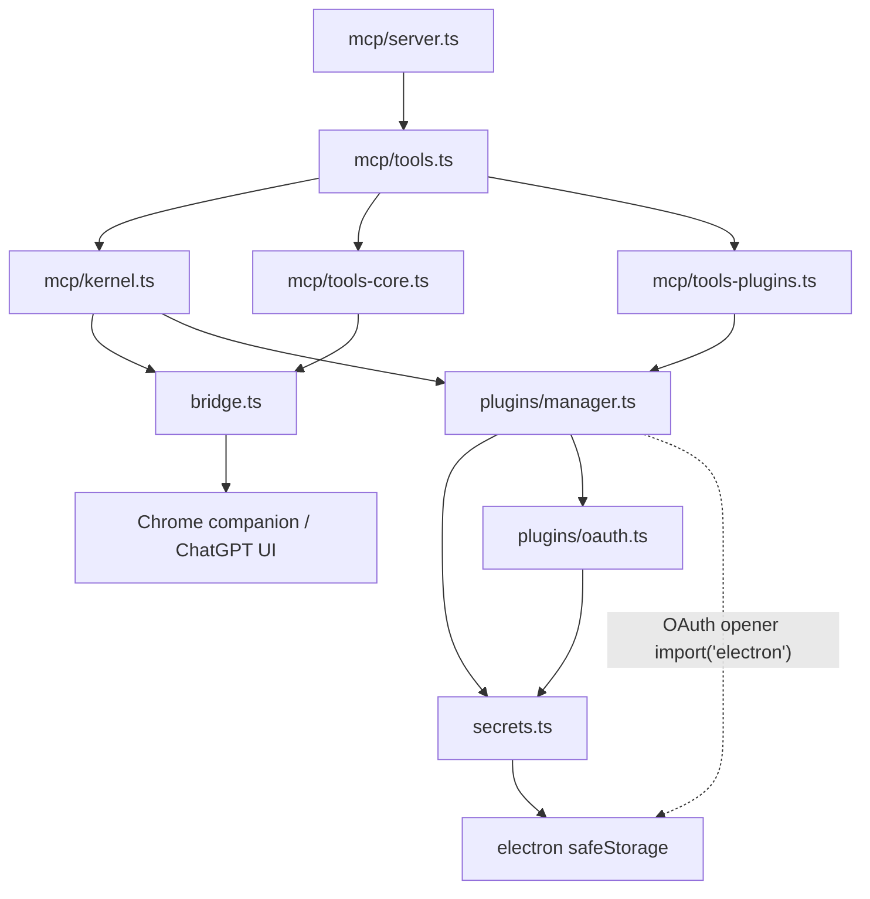

# Phase 0 — Ubuntu Server Headless 리팩터링 기준선 조사 보고서

> **상태:** GitHub 원본·fork 소스 정적 분석 및 upstream CI 결과 확보 완료. **독립 Ubuntu Server headless 재현/전체 import 그래프는 미실시(미해결 게이트로 기록).**  
> **분석일:** 2026-10-11 (KST)  
> **기준 Upstream:** `totec448-spec/chat-on-steroids` @ `1d23ecdb8ab4dd5864f7f835778f539c51128526`  
> **작업 대상:** `ELSAPHABA/chat-on-steroids-headless` / `feat/headless-refactoring`  
> **원본 버전:** `package.json` 2.1.34  
> **설계 기준:** [Headless_Refactoring_Specification.md](Headless_Refactoring_Specification.md) v1.2.0  
> **범위:** Chromium companion/ChatGPT 브라우저 제어 제외, 외부 Playwright MCP 유지, Blender/Unity 기본 지원 제외

## 1. Phase 0 체크리스트 및 검증 수준

| ID | 요구 항목 | 조사 산출물 | 상태 |
| --- | --- | --- | --- |
| P0-01 | 원본 SHA 및 작업 브랜치 기준선 고정 | 상기 source SHA, branch 비교 | **완료** |
| P0-02 | npm·런타임·네이티브 의존성 인벤토리 | `package.json` / `package-lock.json` / 빌드 명령 분석 | **정적 조사 완료** |
| P0-03 | 소스 트리 구성과 모듈 관계 | 중요 모듈 14개 직접 관계 + [RPi3 실측 전수 lexical import 검사](Phase0_RPi3_Test_Report.md): `src` 299개 파일/1,175개 내부 edge | **정적 상대경로 검증 완료 / AST·CI 차단 게이트 미완료** |
| P0-04 | 공개 MCP surface 및 도구 목록 | `src/main/mcp/{server,tools,surfaces}.ts`, `tools-plugins.ts` | **정적 스냅샷 완료** |
| P0-05 | 기본 플러그인 및 외부 소스 유형 | `plugins/{catalog,manager,installer,exposure,oauth}.ts` | **완료** |
| P0-06 | CI/테스트 기준선 | 동일 SHA의 upstream CI 성공; RPi3 Venv 계약 검사 **18/18 통과**; npm 설치 **미완료** | **정적 검사 완료 / fork TypeScript·Vitest 미실시** |
| P0-07 | 라이선스·보안 이관 위험 | `SECURITY.md`, `docs/plugins.md`, `docs/licenses/*`, `package.json` 및 관련 코드 조사 | **위험 목록 완료 / 제품별 준수 재검증 필요** |
| P0-08 | 서버 전용 배포/실행 가능성 실증 | 신규 Node entrypoint 없는 상태 | **불가: Phase 1 이후 검증** |

**결론:** 재사용 가능한 Core/Plugins 구현은 확인되었지만 현 상태는 standalone headless 프로그램이 아니다. **RPi3 환경에서 전체 `src` 299개 TypeScript 파일의 lexical import 경로를 검사해 미해결 경로 0개를 확인**했으나, **정식 TypeScript AST/CI 금지 import 검사 및 fork npm/타입/Vitest 테스트는 아직 완료하지 못했다.** Phase 1 코드 변경은 이러한 차단 게이트를 고려해야 한다. 자세한 실측 결과는 [Phase0_RPi3_Test_Report.md](Phase0_RPi3_Test_Report.md)에 기록했다.

## 2. Source baseline

### 2.1 리포지터리 상태

- 원본 `main` 및 fork `main` 은 조사 시점에 동일한 SHA `1d23ecdb8ab4dd5864f7f835778f539c51128526` 를 가리켰다.
- fork의 `feat/headless-refactoring` 에는 **문서만 변경**되어 있으며 기존 소스코드 및 빌드 계약 변경 없음.
- 원본의 `package.json` 버전 2.1.34. Electron 중심 빌드 스크립트 `npm run build` = `electron-vite build`.
- 분석된 고정 소스 트리의 파일 수: **1,218개 blob**(git tree 응답에서 파일만 집계), `src/main` TypeScript **177개**, `src/shared` TypeScript **55개**, `src/renderer` TypeScript **62개**, `src/preload` TypeScript **5개**.
- `test/**/*.test.ts` **325개 파일**(테스트 케이스 개수와 다름). 여러 영역이 겹치므로 아래 테스트 그룹 숫자는 단순 합산하지 않는다.
- 현재 `src/headless` 독립 실행 엔트리포인트는 없다.

### 2.2 npm 및 Linux 네이티브 호환성

| 의존성 | 분석 버전 | 용도 / 확인 사항 |
| --- | --- | --- |
| `electron` | 44.3.0 (dev) | GUI/`safeStorage`/트레이/창 결합, **headless 번들에서 제거해야 함** |
| `electron-vite` | ^5.0.0 (dev) | 기존 빌드에만 사용. Node-only tsconfig/빌드 스크립트 신설 |
| `@modelcontextprotocol/server` | ^2.0.0 | MCP server 핵심. Node-only 실행 회귀 검증 |
| `@modelcontextprotocol/node` | ^2.1.0 | HTTP adapter, 요청 검증. Node-only 실행 회귀 검증 |
| `@modelcontextprotocol/client` | ^2.1.0 | 외부 MCP stdio/HTTP 클라이언트, OAuth |
| `@anthropic-ai/mcpb` | ^2.1.2 | MCPB parsing 및 플러그인 설치 |
| `node-pty` | 1.2.0-beta.15 | Linux PTY 네이티브 바이너리/ABI 실제 설치 테스트 필요 |
| `sharp` | 0.35.4 | 이미지 처리 네이티브 아티팩트 및 Linux/arm64 검증 |
| `koffi` | 3.3.2 | native FFI; headless 배포에서 실제 필요 여부 점검 |
| `tree-sitter` / `tree-sitter-bash` | 0.25.1 | 파서 네이티브 의존성, Node ABI/아키텍처 점검 |
| `@jitl/quickjs-wasmfile-release-sync` | 0.32.0 | code mode용 Wasm 런타임, 동작·메모리 검증 |
| `ws` | 8.22.0 | websocket 종속성; UI/bridge 외 잔존 수요 확인 |
| `typescript` | ^7.0.2 (dev) | 새로운 Node-only 컴파일러 설정 검증 |
| `vitest` | ^5.0.2 (dev) | 서버/플러그인 테스트 재사용 가능 |

**주의:** npm 의존성 목록은 정확한 `package.json` 직접 의존성/범위를 기준으로 하며 설치된 바이너리·OS 라이브러리와 `package-lock.json` 전체 transitive 의존성의 런타임 검증은 수행하지 않았다. **Node 24 채택은 확정하지 않음**: upstream CI의 검증 환경은 **Node 22**이다. Phase 1의 1차 수용 기준은 Node 22로 잡고, Node 24는 별도 매트릭스가 통과한 뒤 도입하는 편이 안전하다.

## 3. 소스 아키텍처와 import 의존성

### 3.1 전체 주요 트리 및 경계

```text
src/main/
  index.ts                  Electron app.whenReady, 창/트레이와 서비스 초기화 결합
  mcp/
    server.ts               Node HTTP MCP listener
    tools.ts                Core / Desktop / Plugins 서버 구성
    kernel.ts               호출자 귀속, 도구 등록, 권한 및 결과 전달
    tools-core.ts           파일, 명령, 계획, agents 등의 실제 Core 도구
    tools-plugins.ts        PluginManager가 제공하는 도구 노출/라우팅
    surfaces.ts             core / desktop / plugins 공개 metadata
  plugins/
    manager.ts              설치 레코드, subprocess, MCP 연결/도구 집계
    installer.ts            npm/Python/command/MCPB/remote 설치
    oauth.ts                OAuth provider + loopback callback
    catalog.ts              원본 7개 플러그인 레시피
    exposure.ts             tools/schema 크기 제한
    uv-runtime.ts           Linux x64/arm64 uv 자산
  codex/*                   실행 및 PTY, 패치, 이미지/명령 결과 처리
  secrets.ts                Electron safeStorage **직접 사용**
  config.ts                 기능/권한/UI 설정 혼합
  connection.ts             MCP endpoint 및 tunnel lifecycle
  bridge.ts                 Chrome companion UI 신호(Headless 제외)
  cos-browser/*             내장 CoS 브라우저(Headless 제외)
  browser-control.ts        ChatGPT 브라우저 제어(Headless 제외)
  session/*, agents.ts      브라우저 기반 대화/worker 귀속 연결
  durable.ts                파일 기반 상태(재사용 유망)
extension/                   Headless 제외
src/preload/                Headless 제외
src/renderer/               Headless 제외
```

### 3.2 직접 import 분석: 우선 조사한 14개 중요 모듈

다음은 지정한 14개 `src/main` 파일의 **정적 import / literal dynamic import**에서 서로 간에 관찰된 연결이다. 내부에서 `src/shared/*`, 여타 main 파일로 이어지는 간접 경로 및 조건부 런타임 require는 아직 완전히 수집하지 않았다.

| 시작 파일 | 조사한 14개 내부의 직접 의존 |
| --- | --- |
| `mcp/server.ts` | `config.ts`, `mcp/tools.ts`, `mcp/surfaces.ts` |
| `mcp/tools.ts` | `mcp/kernel.ts`, `mcp/tools-core.ts`, `mcp/tools-plugins.ts`, `mcp/surfaces.ts` |
| `mcp/kernel.ts` | `plugins/manager.ts`, `config.ts`, `mcp/surfaces.ts`, **`bridge.ts`** |
| `mcp/tools-core.ts` | **`bridge.ts`**, `config.ts`, `mcp/surfaces.ts`, `mcp/kernel.ts` |
| `mcp/tools-plugins.ts` | `plugins/manager.ts`, `config.ts`, `mcp/kernel.ts` |
| `mcp/surfaces.ts` | `config.ts` |
| `plugins/manager.ts` | **`secrets.ts`**, `plugins/installer.ts`, `plugins/catalog.ts`, `mcp/surfaces.ts`, `plugins/oauth.ts` |
| `plugins/installer.ts` | `plugins/catalog.ts` |
| `plugins/catalog.ts` | 없음(이 14개 사이 기준) |
| `plugins/oauth.ts` | **`secrets.ts`** |
| `connection.ts` | `config.ts`, `mcp/server.ts`, `mcp/tools.ts`, `mcp/surfaces.ts`, `secrets.ts`, `plugins/manager.ts` |
| `secrets.ts` | 없음(이 14개 사이 기준), 그러나 **Electron safeStorage 직접 import** |
| `config.ts` | 없음(이 14개 사이 기준) |
| `bridge.ts` | `config.ts`, `secrets.ts` |

### 3.3 차단된 경로(구현 전 해소 필요)



- **블로커 B-01:** `mcp/server → tools → kernel → bridge`. Tool handler만 서버에서 가져와도 companion 브리지 코드가 로드될 수 있으므로 **browser-free caller identity/attribution 포트**로 교체.
- **블로커 B-02:** `mcp/tools-core → bridge` 직접 참조(예: worker chat/image-related 흐름). 서버용 Core 등록에서 페이지 연동형 도구 `agents`·`session_finish` 등을 분리.
- **블로커 B-03:** `plugins/manager → secrets → electron safeStorage` 및 매니저의 Electron OAuth opener. **SecretStore 인터페이스와 PluginAuthPresenter 주입**을 먼저 수행.
- **블로커 B-04:** `mcp/surfaces` 는 `desktop` 정의·브라우저 tool metadata를 포함하므로 서버 전용 surface 구성에서 제거/정적 분리.
- **블로커 B-05:** `config.ts` 의 브라우저/GUI 설정 스키마. 범용 권한 정책을 유지하되 Node daemon 설정을 별도로 구성.
- **블로커 B-06:** `codex/ownership.ts` 가 session request-correlation에 연결됨. 웹 대화 식별 없이 실행 프로세스 소유권을 인정할 새로운 인증 principal 필요.

**재사용 유망:** `mcp/server` HTTP 제한·유효성 검증, `mcp/tools-plugins` JSON Schema/result proxy, `plugins/installer` 검증된 설치 계약, `durable.ts`, `codex/shell.ts`/`unified-exec.ts`. 재사용은 독립적으로 실행 가능하다는 의미가 아니다.

### 3.4 범위 명시 및 불확실성

- `src/main/**/*.ts` 총 **177개** 파일의 **파일명 인벤토리 확인**.
- 의존 관계는 위의 핵심 **14개 파일**에 대해 직접 import를 조사했으며, **177개 전수 그래프/AST 기반 분석이 완료되었다고 표기하지 않는다**.
- Phase 1 시작 전에는 전체 TypeScript import graph를 생성하고, new `src/headless/main.ts` 에서 `electron`, `bridge`, `cos-browser`, `browser-control`, `computer`로 도달하는 경로를 CI에서 **0개**로 만들 것.
- 브라우저 미사용 파일이라도 `src/shared` 의 재수출 등 간접 의존성을 통한 번들 유입을 탐지할 것.

## 4. MCP surface 계약 기준선

원본 `src/main/mcp/surfaces.ts` 에서는 다음 **3개** surface가 선언되어 있다.

| Surface | 서버명 | 선언된 도구 | Headless 목표 |
| --- | --- | --- | --- |
| Core | `chat-on-steroids-core` | `read`, `view_image`, `find`, `apply_patch`, `save_image`, `exec_command`, `write_stdin`, `update_plan`, `agents`, `session_finish`, `exec` | **보존 후보 9개**, `agents`·`session_finish` 보류 |
| Desktop | `chat-on-steroids-desktop` | Browser Control 및 OS native desktop 관련 동적 도구 | **전체 미노출** |
| Plugins | `chat-on-steroids-plugins` | 카탈로그가 아닌 **설치된 서버의 live-discovered 도구** + 조건부 code mode `exec` | **보존** |

**주의:** 위 목록은 `surfaces.ts`의 **최대 후보 선언**, 실제 `tools/list` 응답의 전체·항상 등록되는 목록이 아니다. `find` 와 `exec_command` 도구 노출은 상호 배타적인 설정 경로가 있고, 각 도구는 권한과 모드에 따라 숨김/거부된다. 따라서 Phase 1에서는 각 capability별 실제 `tools/list` 스냅샷을 fixture로 작성해야 한다.

공통 모델/제약:
- `@modelcontextprotocol/server` + `@modelcontextprotocol/node` 의 Streamable HTTP adapter.
- `mcp/server.ts`: `127.0.0.1` listener, 경로별 secret token, Host/Origin 검증, 요청 body **8 MiB** 제한 및 graceful stop/drain.
- `mcp/tools.ts`: Surface별 독립 handler, unknown tool cross-surface 호출 불가, live permission을 유지하면서 cached schema용 등록 안정성 유지.
- `tools-plugins.ts`: 외부 MCP 도구의 원래 JSON Schema/structured output 변형 최소화, manager의 enable 정책 검사, code mode 자체 tool registration.
- `plugins/exposure.ts`: `PLUGIN_MAX_TOOLS=256`, `PLUGIN_MAX_SCHEMA_BYTES=250000`. **실제 exposed tool list는 동적이며 고정된 도구 수를 주장할 수 없음**.
- 외부 노출은 `connection.ts` 와 `tunnel/*`, `cloudflared` / OpenAI Secure Tunnel adapter를 통해 별도 관리.
- Headless에서는 원본 3개 중 **Core/Plugins만 생성**, 기존 Desktop MCP와 CoS 브라우저 컨트롤은 생성·등록하지 않는다.

## 5. 플러그인 계약 및 고정 카탈로그

### 5.1 원본 7종 vs Headless 5종

| ID | 원본 package / kind | 버전 | Headless 포함 여부 |
| --- | --- | --- | --- |
| `blender` | Python `blender-mcp` | 1.9.1 | **제외** |
| `memory` | npm `@modelcontextprotocol/server-memory` | 2026.8.31 | **포함** |
| `playwright` | npm `@playwright/mcp` | 0.0.80 | **필수 포함, 자체 headless 브라우저** |
| `fetch` | Python `mcp-server-fetch` | 2026.8.18 | **포함** |
| `heygen` | Remote OAuth `https://mcp.heygen.com/mcp/v1/` | Remote | **포함, OAuth 서버 대응** |
| `recraft` | Remote OAuth `https://mcp.recraft.ai/mcp` | Remote | **포함, OAuth 서버 대응** |
| `unity` | Python `mcpforunityserver` | 10.2.0 | **제외** |

- 원본 7개는 **현재 코드의 사실**이고, Headless 5개는 **미구현 설계 목표**다. 현재 branch 소스의 catalog를 변경하지 않았다.
- `plugins/installer.ts` 는 `npm`, `python`, `command`, `mcpb`, `remote` 를 직접 처리하고, `github` 은 사전 검증한 레시피로 매핑해 설치한다.
- 원본 플러그인 런타임은 stdio subprocess와 remote HTTP client를 지원한다.
- Playwright의 `browser_navigate`, `browser_snapshot`, `browser_click`, `browser_fill_form`, `browser_tabs`, `browser_take_screenshot` 는 원본 카탈로그의 **대표 도구명**. 실제 MCP 서버가 설치 후 반환하는 도구는 version/discovery 결과가 진실이다.
- **Blender·Unity 제외는 Headless 기본 레시피/지원 범위 제외**를 의미한다. 범용 사용자 지정 `command` source를 악용 불가능하게 바꾸거나 원본 데스크톱 카탈로그를 삭제할 필요는 없다.
- OAuth 브라우저 오프너가 `PluginManager` 내부에서 Electron shell에 의존하고, `PluginOAuth` callback이 `127.0.0.1` 랜덤 포트를 사용한다. 서버-관리자 PC가 분리된 경우 URL 출력 + 안전한 forwarding/relay가 필요하다.

### 5.2 지원해야 하는 테스트 계약

- `test/plugins-installer.test.ts`, `plugins-manager.test.ts`, `plugins-exposure.test.ts`, `plugins-surface.test.ts`, `plugins-oauth.test.ts`, `uv-runtime.test.ts`.
- `test/plugins-live-proxy.test.ts`, `plugins-python-live.test.ts`, `plugins-catalog-live.test.ts` 는 upstream CI에서 `COS_PLUGIN_LIVE_TEST=1` 로 실행됨.
- **Playwright-specific headless 추가 테스트는 아직 존재한다는 근거 없음**: Phase 3에서 설치→실제 브라우저 시작→navigate/snapshot/screenshot→종료 테스트 구현 필수.
- Blender·Unity headless 레시피 표시 금지 테스트 추가. 원본 GUI 테스트를 fork에서 삭제하지 말고, Headless 테스트 타깃에서 분리.

## 6. Upstream 빌드/테스트 기준선 및 재현성

### 6.1 증빙 — 동일 원본 SHA의 실제 GitHub Actions

| 실행 | 대상/조건 | 검증 결과 | 증거 |
| --- | --- | --- | --- |
| **CI** Run `38129900320` | upstream push on source SHA, Ubuntu 24.04 Linux x64 / Windows x64 / macOS arm64 | **전체 성공** (각 플랫폼 Install dependencies, Verify, published plugin suites success) | [원본 CI](https://github.com/totec448-spec/chat-on-steroids/actions/runs/38129900320) |
| **Canary** Run `38129900490` | 동일 SHA의 Linux x64, Windows x64, macOS arm64 배포 경로 | **전체 성공** (Linux x64 package job 포함) | [원본 Canary](https://github.com/totec448-spec/chat-on-steroids/actions/runs/38129900490) |
| **Fork 작업 브랜치 CI** | `feat/headless-refactoring` | **실행 기록 없음** (문서-only 브랜치) | GitHub Actions API 확인 |
| **독립 서버 로컬 테스트** | Ubuntu Server / Node-only | **미실시** | 현재 Node-only entrypoint 부재 |

`.github/workflows/ci.yml` 의 **실제 환경**:
- OS matrix: `ubuntu-24.04`, `windows-2025`, `macos-15`.
- **Node 22**, `npm ci`, `npm run verify:ci`.
- Python 3.12 + CI plugin runtime `uv==0.12.5` 설치.
- `COS_PLUGIN_LIVE_TEST=1 npx vitest run --maxWorkers=1 test/plugins-live-proxy.test.ts test/plugins-python-live.test.ts test/plugins-catalog-live.test.ts`.
- `npm run verify:ci`: ripgrep/bootstrap, privacy/notices checks, `tsc --noEmit`, Electron 존재 확인, Vitest(일부 종료·컴퓨터 테스트 별도 실행).
- `vitest.config.ts`: Node 테스트 환경, timeout 30초, CI의 `COS_TEST_RETRY=1` 플래키 재시도. **성공에 retry가 포함될 수 있으므로 테스트의 무플래키 상태를 증명하지 않는다.**
- 실제 GUI 포함 CI 성공은 **Electron Linux 앱에 한정**되며 headless 서버 부팅을 검증한 사실이 아니다.

### 6.2 새 Headless 게이트(향후 구현)

```bash
# 기존 upstream baseline (원본 코드 환경)
npm ci
npm run typecheck
npm run verify:ci

# Phase 1에 신설할 계약 — 현재 존재하지 않는 명령
npm run build:headless
npm run test:headless
node dist/headless/main.js --help
env -u DISPLAY node dist/headless/main.js doctor
```

새로운 Ubuntu CI job은 최소한 Node 22 기반으로 시작하고, Node 24를 추가로 평가한다. 설치·브라우저 패키지·서비스 unit 검증은 별도 job으로 분리한다.

## 7. 라이선스·배포·보안 위험

| 항목 | 조사 결과 | 필요한 후속 검증 |
| --- | --- | --- |
| 프로젝트 라이선스 | 원본은 MIT / third-party notices 구비 | 원본 고지 보존, fork 저작권 고지 검토 |
| npm/OS 네이티브 모듈 | `THIRD-PARTY-NOTICES.txt`, `docs/licenses/native/*`, `docs/plugin-notice-audit.md` 존재 | 서버 전용 패키지에서 실제 배포 binary에 해당하는 라이선스와 source/relink 의무 재생성/검증 |
| 외부 MCP 플러그인 | `docs/plugins.md`: 프로세스는 서비스 계정 OS 권한으로 실행하며 CoS roots sandbox를 자동 상속하지 않음 | 서비스 사용자·프로세스/컨테이너 격리 및 네트워크·파일 접근 정책 |
| `secrets.ts` | Electron `safeStorage` 의 Linux `basic_text` fallback 거부 | 무인 Linux secret backend 필수, fail-closed & 마이그레이션 금지 정책 |
| Browser / Extension | 브리지에 대화/ChatGPT 상태·컨트롤 집중 | Headless import graph에서 완전 배제, 제외 기능 stale 호출 금지 |
| Remote MCP | 원본 loopback token+Host+Origin 방어 | TLS/인증된 접근경로·secret URI 유출·proxy header 안전성 검증 |
| OAuth | 서버의 `127.0.0.1` callback, Electron opener | SSH port-forward 또는 공식 지원되는 서버 안전 인증 경로 설계 |
| Native executable/PTY | Linux glibc, ABI, 서비스 계정 PATH 의존 | Node 22/24 clean install, systemd user/run, termination 테스트 |

## 8. Phase 1 착수 조건과 열려 있는 게이트

**Phase 0에서 확정할 수 있는 선택:**
1. Node.js의 Core + Plugins라는 범위를 유지하고 Desktop/companion을 제외한다.
2. Playwright MCP는 독립 subprocess로 유지하며 기본 플러그인 **5개만 노출**한다.
3. 브라우저/GUI/시크릿 직접 import를 Node-only 데몬 엔트리포인트에서 제거할 수 있도록 HostRuntime/SecretStore/CallerContext 의존 역전을 먼저 한다.
4. CI 실증 환경은 **Node 22 + Ubuntu 24.04**로 시작한다. Node 24는 합격 결과를 얻은 뒤 결정한다.
5. UI 기반 agents/Goal/Compact & Resume의 기존 약속은 Headless MVP에 포함하지 않는다.

**미해결(Phase 1에 앞서 진행하거나 Phase 1의 첫 PR에서 차단 게이트로 처리):**
- [x] **P0-G1a — lexical 전수 조사:** DevSpace RPi3의 HongDevVenv Python으로 전체 `src` TypeScript 299개(이 중 `main` 177, `shared` 55)를 스캔하여 내부 상대경로 edge 1,175개, 경로 미해결 0개 확인([실측 보고서](Phase0_RPi3_Test_Report.md)).
- [ ] **P0-G1b — 완전한 CI 게이트:** TypeScript AST/type-only·비정적 import·runtime 번들 의존성 확인 및 신규 Headless entrypoint에서 Electron/브라우저 모듈 전이 도달 0개를 검증하는 자동 게이트 구축.
- [ ] **P0-G2 — 여전히 차단:** RPi3 Ubuntu 24.04.5 ARM64에서 `npm ci` 실행했지만 호출 시간 제한, 오프라인 재시도 `ENOTCACHED` 및 Node 24.14.0 일부 패키지 엔진 경고로 설치 미완료. 따라서 `npm run typecheck` / `npm run verify:ci` **미실시**. 원본 CI(Node 22, Ubuntu x64)와 RPi3가 다르며 재현 증빙은 현재 **upstream** 실행 기록만 있음([실측 보고서](Phase0_RPi3_Test_Report.md)).
- [ ] **P0-G3** Phase 1 CI에서 Node-only entrypoint의 import graph 검증과 Electron/bridge module 배제 자동 게이트를 추가할 것.
- [ ] **P0-G4** 기존 secret 저장 포맷의 서버 변환 여부 정책을 확정; 기본값은 자동 import 금지·재등록.
- [ ] **P0-G5** 원본 `mcp/surfaces.ts` 의 등록 가능 이름과 실제 permission별 `tools/list` fixture 비교; 동적 플러그인 도구는 mock/live 분리.

## 9. 참조 및 원문

- [고정 SHA package.json](https://github.com/totec448-spec/chat-on-steroids/blob/1d23ecdb8ab4dd5864f7f835778f539c51128526/package.json)
- [원본 CI YAML](https://github.com/totec448-spec/chat-on-steroids/blob/1d23ecdb8ab4dd5864f7f835778f539c51128526/.github/workflows/ci.yml) / [vitest 설정](https://github.com/totec448-spec/chat-on-steroids/blob/1d23ecdb8ab4dd5864f7f835778f539c51128526/vitest.config.ts)
- [MCP server](https://github.com/totec448-spec/chat-on-steroids/blob/1d23ecdb8ab4dd5864f7f835778f539c51128526/src/main/mcp/server.ts) / [MCP kernel](https://github.com/totec448-spec/chat-on-steroids/blob/1d23ecdb8ab4dd5864f7f835778f539c51128526/src/main/mcp/kernel.ts) / [MCP surfaces](https://github.com/totec448-spec/chat-on-steroids/blob/1d23ecdb8ab4dd5864f7f835778f539c51128526/src/main/mcp/surfaces.ts)
- [plugins catalog](https://github.com/totec448-spec/chat-on-steroids/blob/1d23ecdb8ab4dd5864f7f835778f539c51128526/src/main/plugins/catalog.ts) / [manager](https://github.com/totec448-spec/chat-on-steroids/blob/1d23ecdb8ab4dd5864f7f835778f539c51128526/src/main/plugins/manager.ts) / [installer](https://github.com/totec448-spec/chat-on-steroids/blob/1d23ecdb8ab4dd5864f7f835778f539c51128526/src/main/plugins/installer.ts)
- [Electron secrets](https://github.com/totec448-spec/chat-on-steroids/blob/1d23ecdb8ab4dd5864f7f835778f539c51128526/src/main/secrets.ts) / [Chrome bridge](https://github.com/totec448-spec/chat-on-steroids/blob/1d23ecdb8ab4dd5864f7f835778f539c51128526/src/main/bridge.ts)
- [기존 plugin 운영·라이선스 문서](https://github.com/totec448-spec/chat-on-steroids/blob/1d23ecdb8ab4dd5864f7f835778f539c51128526/docs/plugins.md) / [보안 정책](https://github.com/totec448-spec/chat-on-steroids/blob/1d23ecdb8ab4dd5864f7f835778f539c51128526/SECURITY.md)
